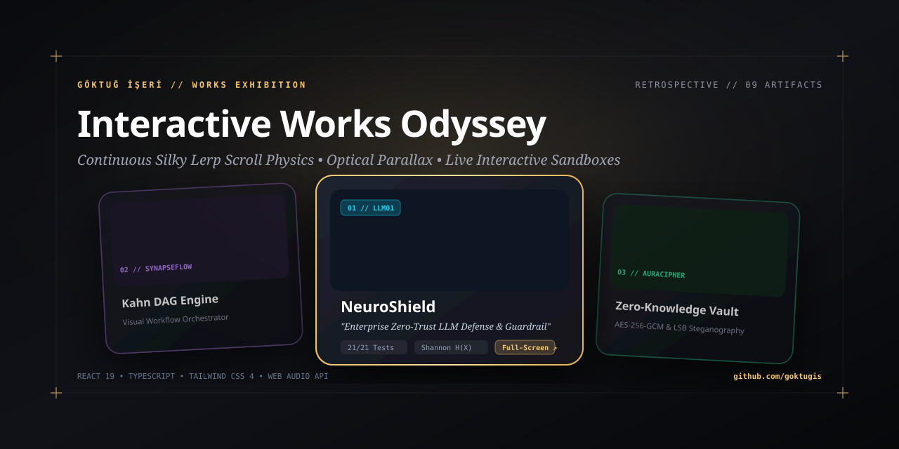
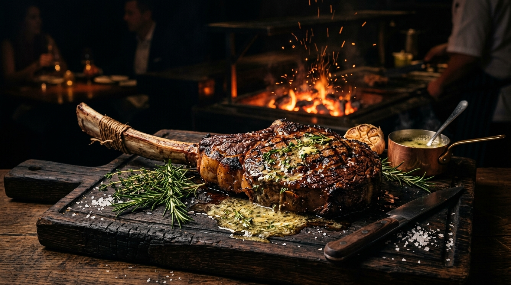
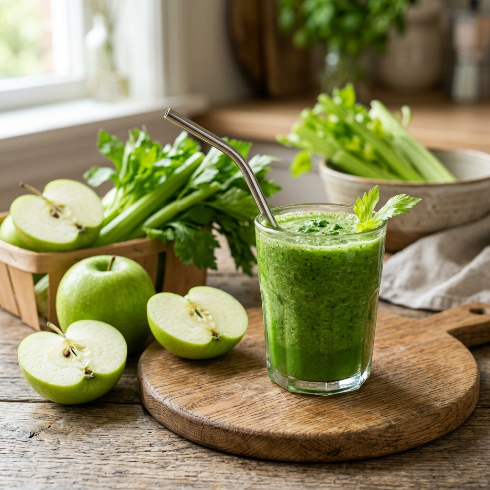

# Göktuğ İşeri — Works Odyssey // Interactive Engineering Exhibition

> Sıradan bir özgeçmiş sayfası yerine; üretilen 9 açık kaynaklı yapay zeka, kriptografi, bilgisayarlı görü ve kurumsal sistemin akıcı bir fizik motoruyla sergilendiği çağdaş interaktif eserler sergisi.



---

## 🏛️ Sergilenen Eserler Galerisi

| [01 // NeuroShield](https://github.com/goktugis/neuro-shield) | [02 // SynapseFlow](https://github.com/goktugis/synapse-flow) | [03 // AuraCipher](https://github.com/goktugis/aura-cipher) |
| :---: | :---: | :---: |
|  |  |  |
| **Kurumsal Zero-Trust LLM Kalkanı**<br>Shannon Entropisi $H(X)$, PII Luhn/TCKN ve OWASP LLM01 savunması. | **Otonom Ajan & Görsel DAG Motoru**<br>Kahn Algoritması $O(V+E)$, DFS döngü koruması ve canlı simülasyon. | **Sıfır-Bilgi Kriptografik Kasa**<br>AES-256-GCM, PBKDF2 100K tur ve LSB piksel steganografisi. |

| [04 // Han Kebap & Steakhouse](https://github.com/goktugis/han-kebap-steakhouse) | [05 // PlanPilot](https://github.com/goktugis/planpilot) | [06 // DietitianApp](https://github.com/goktugis/DietitianApp) |
| :---: | :---: | :---: |
|  |  |  |
| **Ultra-Lüks Gastronomi Deneyimi**<br>Dry-Aged interaktif pişme derecesi simülatörü ve VIP rezervasyon motoru. | **KOBİ Akıllı Talep & Randevu Sistemi**<br>SQLite3, Express REST API ve çakışma önleyici zamanlayıcı. | **Klinik Beslenme & Hasta Takip (.NET)**<br>C# ASP.NET Core MVC, Docker desteği ve BMR/BMI hesaplayıcı. |

| [07 // HCC Survival Prediction](https://github.com/goktugis/machine_learning_HCC_survival_project) | [08 // VisionTracker (Görüntü İşleme)](https://github.com/goktugis/Goruntu-Isleme) | [09 // Oil Spill Detection](https://github.com/goktugis/machine_learning_oill_spill_project) |
| :---: | :---: | :---: |
|  |  |  |
| **Klinik Onkoloji Sağkalım Tahmini**<br>Scikit-Learn, Random Forest, ROC-AUC 0.91 ve biyobelirteç analizi. | **Gerçek Zamanlı OpenCV Renk Takibi**<br>HSV renk uzayı segmentasyonu, morfolojik filtreler ve merkez (centroid) takibi. | **Uydu Radar Felaket Sınıflandırma**<br>MATLAB & Python spektral doku öznitelikleriyle deniz petrol tespiti. |

---

## 🌟 Temel Deneyim & Mimari Özellikler

- **🧈 Kesintisiz "Lerp" Yumuşak Kaydırma Fiziği**:
  - `requestAnimationFrame` tabanlı sürekli doğrusal enterpolasyon (`currentX += (targetX - currentX) * 0.068`) ile fare tekerleği ve trackpad üzerinde yağ gibi süzülen eylemsizlik fiziği.
- **🎬 Optik Katman Paralaksı (Optical Parallax)**:
  - Kartlar runway üzerinde ilerlerken, kartın içindeki yüksek çözünürlüklü görseller bağımsız bir hızda (`parallaxOffset`) ters yöne süzülerek üç boyutlu derinlik yanılsaması yaratır.
- **✨ Karta Tıklamayla Tam Ekran Morf Deneyimi**:
  - Kartların üzerinde gereksiz buton kalabalığı yoktur; eserin herhangi bir yerine tıklandığında kart 700 ms sinematik yaylanmayla ekranın ortasından genişleyerek tam ekran vitrinine dönüşür.
- **🧪 Canlı İnteraktif Simülatörler (In-Browser Live Sandboxes)**:
  - **NeuroShield**: Gerçek zamanlı Shannon Entropi formülü ($H(X)$), Luhn kredi kartı ve prompt injection test istasyonu.
  - **SynapseFlow**: 5 düğümlü Kahn algoritması topolojik sıralama ($O(V+E)$) adım adım yürütücüsü.
  - **AuraCipher**: Yazılan metni PNG RGB piksellerinin en anlamsız bitine (LSB) enjekte eden steganografi laboratuvarı.
  - **Han Kebap**: Rare'den ($52^\circ\text{C}$) Well-Done'a ($71^\circ\text{C}$) sıcaklık ve mühürlenme derecesi simülatörü.
  - Ve diğer tüm projelerin çalışır durumdaki matematiksel simülasyonları!
- **🏺 Liquid Champagne & Smoked Obsidian Paleti**:
  - Soğuk/bayat uzay klişeleri yerine; sıcak şampanya altını (`#f5c56e`), füme obsidiyen (`#0a0b0e`), sıcak halojen sergi aydınlatması ve usulca yükselen mikro kor parçacıkları.
- **🎵 Prosedürel Web Audio API Akustiği**:
  - Harici hiçbir ses dosyası indirmeden, tarayıcının yerel `AudioContext` osilatörleriyle sentezlenen dokunsal ahşap ve akustik marimba tıkırtıları (açılabilir / kapatılabilir).

---

## 🛠️ Teknoloji Yığını

- **Frontend Core**: React 19, TypeScript
- **Styling & Typo**: Tailwind CSS 4, Syne, Newsreader, JetBrains Mono
- **Motion & Physics**: Custom Lerp Momentum Engine (`requestAnimationFrame`), CSS 3D Transforms
- **Audio Engine**: Web Audio API (Native Procedural Synthesizer)
- **Icons & Assets**: Lucide Icons, Custom SVG Architecture Blueprints
- **Bundler & Tooling**: Vite 8, Oxlint

---

## 💻 Kurulum & Yerel Çalıştırma

```bash
# Projeyi klonlayın
git clone https://github.com/goktugis/goktug-portfolio.git
cd goktug-portfolio

# Bağımlılıkları yükleyin
npm install

# Geliştirici sunucusunu başlatın
npm run dev
```

Uygulama varsayılan olarak `http://localhost:5173` adresinde çalışacaktır.

---

## 📄 Lisans

Bu proje MIT lisansı altında açık kaynak olarak sunulmaktadır.
Eserlerin tüm hakları ve telifleri **Göktuğ İşeri**'ye aittir.
